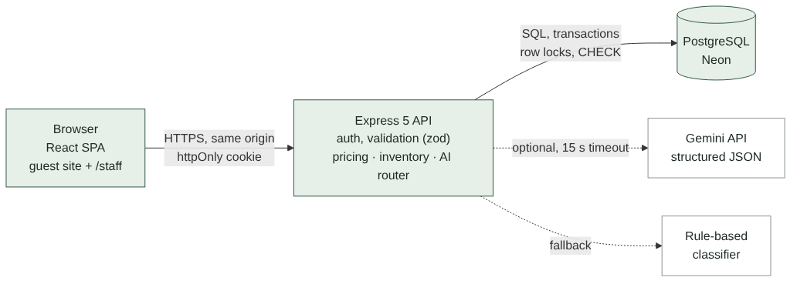
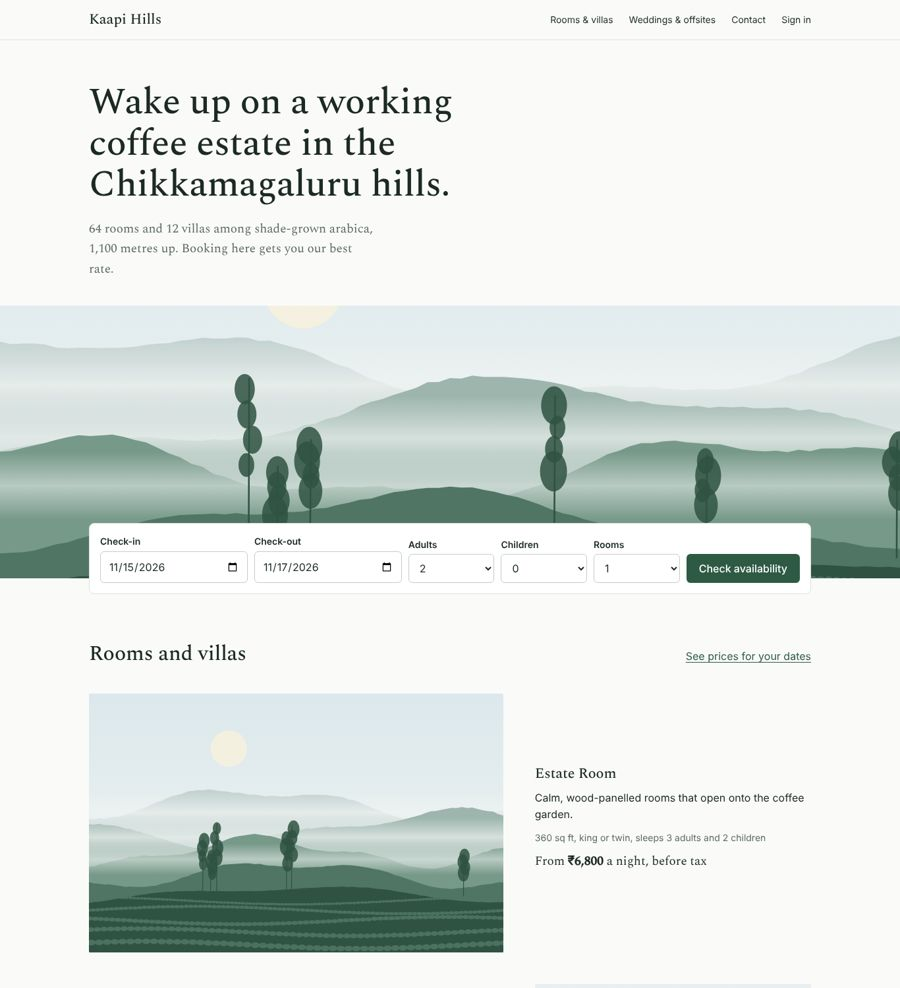
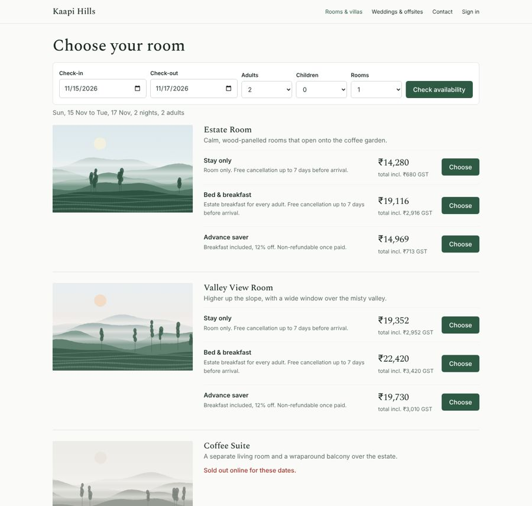
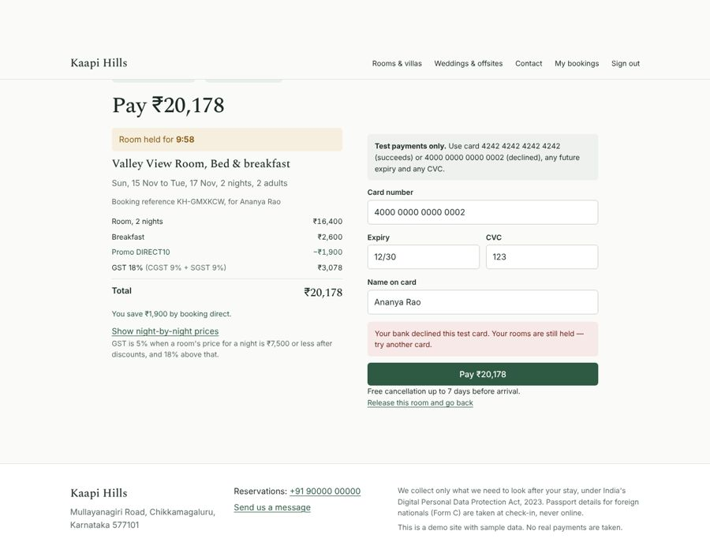
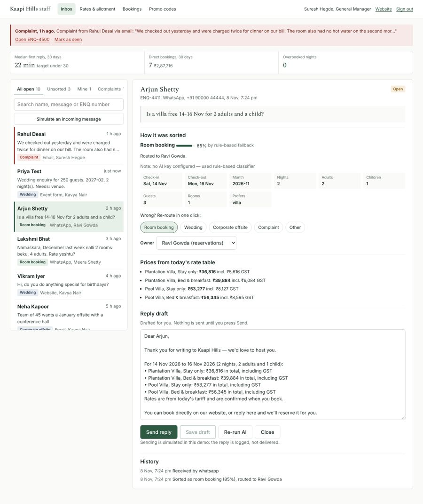
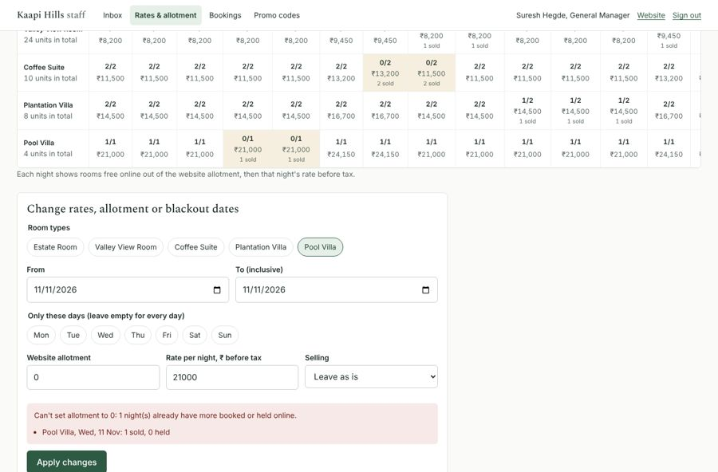
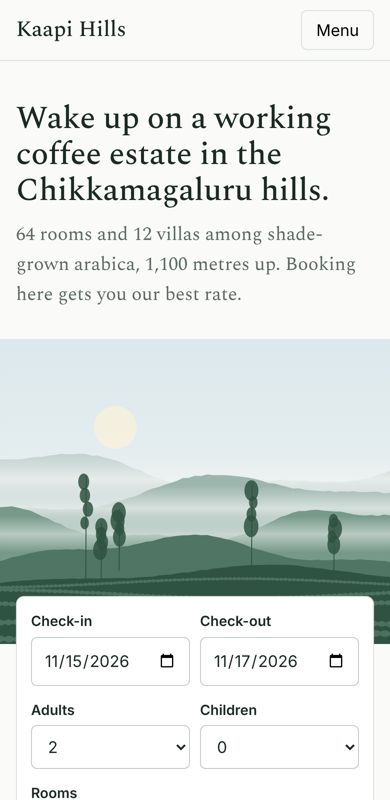

**GitHub:** _add your repository URL_  
**Live demo:** _add your Render URL_  
**Demo logins:** guest@kaapihills.test / Guest@123 · reservations@kaapihills.test / Staff@123 · gm@kaapihills.test / Gm@12345 (full list in deployment.md)

# 1. What I built, in one paragraph

A direct-booking website and a staff back office for a 76-key coffee-estate resort. Guests search dates and see live availability. Each price includes GST at the right slab. They pick a rate plan and pay with a test card in three steps. Reservations staff control the daily rate, the **website allotment** and blackout dates for each room type and night, manage promo codes and export each day's bookings. Messages from the web form, the event form, forwarded email and WhatsApp land in **one inbox**. There an AI router classifies them, extracts dates, guests and budget, assigns an owner and drafts a reply. Staff can correct it in one click and always send the reply themselves.

Two things carry the design. **The site cannot oversell**: this is enforced in the database and proven by a concurrency test. **The AI is never trusted with anything that matters**: not prices, not sending, and not the final say on complaints.

Assumptions are labelled **A1–A17** in `docs/assumptions.md` and referenced below.

# 2. Architecture and why



| Decision | Why |
|---|---|
| **One deployable**: Express serves the API and the built React app | Same origin means a first-party httpOnly session cookie, no CORS and one Render service. That's simpler to run and to secure. |
| **PostgreSQL** | The hard part is a concurrency guarantee. Row locks, transactions and CHECK constraints give it at the database level, so it doesn't depend on the code alone being right. |
| **Inventory as one row per room type per night** (`allotment`, `sold`, `held`, `rate`, `closed`) | This matches how hotels think. It makes "can I sell N rooms on these nights?" a single indexed query, and gives admins a grid they already understand. |
| **Integer paise for money** | No floating-point drift in totals or tax. |
| **Pricing as a pure function** | Every GST and discount rule is unit-tested without a database. The server calculates prices; the browser only displays them. |
| **Gemini with structured JSON output, plus a deterministic fallback** | Live enquiries get a good model. The demo, the tests and outages still work without a key, and nothing breaks if the AI misbehaves. |
| **React + Vite, no UI kit, one self-hosted font** | Small bundle (86 KB gzipped for the first load, staff app split out), fast on slow hill-station networks, full control over a quiet design. |

# 3. Data model

| Table | Key columns | Notes |
|---|---|---|
| `users` | email, password_hash (bcrypt), role `guest`/`staff`/`gm`, team | Sign-up only ever creates guests (A17). |
| `room_types` | name, kind room/villa, max adults/children, base occupancy, extra-adult charge, `total_units` | 30/24/10/8/4 keys (A2). |
| `rate_plans` | code, breakfast per adult, discount %, refundable | Stay only, B&B, Advance saver (A11). |
| `inventory` | **PK (room_type_id, stay_date)**, allotment, sold, held, rate_paise, closed | `CHECK (sold + held <= allotment)` makes overselling impossible. |
| `promo_codes` | code, discount %, min nights, check-in window, max uses, used, active | |
| `bookings` | ref, user, room type, plan, dates, rooms, guests, guest contact, `price` (JSONB night-by-night breakdown), total, status `held/confirmed/cancelled/expired`, hold_expires_at, payment_ref, consent_at | Price is frozen at the moment of the hold. |
| `enquiries` | ref, channel, message, form_data, category, confidence, extracted (JSONB), lane `routed/unsorted`, owner, needs_gm, draft_reply, quote (JSONB), sent_reply, replied_at, ai_source, ai_note | |
| `enquiry_events` | enquiry, user, action, detail | Audit trail: classified, re-routed, edited, sent. |
| `alerts` | kind, enquiry, message, read_at | GM complaint alerts. |

# 4. The hard part: never overbook

**Hold.** Inside one transaction the server first releases any expired holds, then runs a single statement over every night of the stay:

```sql
UPDATE inventory SET held = held + $rooms
WHERE room_type_id = $1 AND stay_date >= $checkIn AND stay_date < $checkOut
  AND NOT closed AND allotment - sold - held >= $rooms
RETURNING stay_date, rate_paise;
```

If fewer rows come back than there are nights, at least one night was full or closed, and the whole transaction rolls back (HTTP 409). Postgres locks each row it updates. A concurrent request for the same night waits for that lock, then **re-checks the WHERE clause against the committed value**, so the last room can only be taken once. The returned rates are the ones the guest is charged.

**Pay.** The booking row is locked (`SELECT … FOR UPDATE`) and must still be `held` and unexpired. `held` then moves to `sold` for each night and the booking becomes `confirmed`. A declined card leaves the hold in place. Paying twice is harmless.

**Expire.** Holds last 10 minutes (A8). They're released lazily before every availability check and hold, and by a 60-second sweeper. One data-modifying SQL statement flips bookings to `expired` and gives the rooms back; it's safe to run concurrently.

**Admin changes.** Lowering an allotment below what is already sold or held on any night is refused as a whole, with the list of clashing nights. Allotment can't exceed the physical number of units. Blackout dates (`closed`) can't be booked.

**Backstop.** The `CHECK (sold + held <= allotment)` constraint means even a future bug can't write an oversold row.

**Proof (tests in `backend/tests/inventory.test.js`):**

- 20 guests book the last Pool Villa at the same moment: exactly 1 succeeds, 19 get 409, and the row ends with held = 1.
- 30 overlapping multi-night bookings against an allotment of 2: no night exceeds the allotment, and every night's `held` equals the sum of its held bookings.
- A raw `UPDATE` that tries to oversell is rejected by the database.
- Expired holds release their rooms once, even with two sweepers racing.
- The suite was run 5 times in a row with no flakes.

# 5. Main flows

**Guest booking (three steps, as the brief asks).**

1. *Choose room*: search dates and guests, then see every room type with its status (available, "2 left online", sold out, closed, too many guests). Each rate plan shows the total including GST.
2. *Your details*: sign in or create an account inline, apply a promo code, enter lead guest details and tick consent. This step creates the 10-minute hold.
3. *Pay*: a countdown from the server's expiry time and the test card form. Then the confirmation page with the full price breakdown and check-in notes (Form C for foreign nationals is done at the desk; A15).

**Pricing rules (A4–A7).** Per room per night: rate + extra adults + breakfast, then the plan discount, then the promo. GST is 5% if that amount is ₹7,500 or less, otherwise 18%. The slab is chosen per room per night after discounts, so a stay can mix slabs (weekday 5%, weekend 18%). Covered by 10 unit tests, including the exact ₹7,500 and ₹7,501 boundaries.

**Staff.** Rates & allotment is a 14-day grid of room types × nights showing free/allotment, rate and sold/held, with bulk editing by date range and weekday (e.g. "Fri–Sat only"). Bookings has filters and a **daily CSV export** (by booking date, arrival or "staying that night"), protected against spreadsheet formula injection. Promo codes can be created and switched off.

**Enquiries.** Web form and structured event form (event type, date or month, guests, nights, rooms, budget, needs). Staff can inject a simulated forwarded email or WhatsApp message.

# 6. How the AI works, and what happens when it's wrong

**Pipeline for each enquiry:**

1. **Classify and extract.** Gemini gets the message, today's date and a system prompt defining the five categories. It must return JSON matching a schema: category, an honest confidence from 0 to 1, a summary, dates, nights, adults, children, guests, rooms, budget, room preference and a draft reply. Temperature is 0.
2. **Validate.** The response is parsed with zod. Anything malformed counts as a failure. On a failure, a timeout (15 s) or no key, the **rule-based classifier** (weighted keywords plus regex extraction for dates such as "14-16 Nov", "Feb 2027" and "December last week", guest counts, and budgets in lakh or k) takes over. The fallback is recorded in `ai_note` and shown to staff.
3. **Sanitise extraction.** Invalid dates (30 Feb), past dates and check-outs before check-ins are dropped rather than shown as fact.
4. **Route.** Confidence ≥ 0.7 → the least-loaded owner in the right team: rooms → reservations, weddings and offsites → sales, complaints → GM (A13). Otherwise the enquiry goes to the **Unsorted** lane with no owner, which the GM sees by default.
5. **Draft and price guard.** The AI is told never to write prices and to use a `{{PRICE_QUOTE}}` token instead. Any amount it writes anyway (₹, Rs, INR, lakh, /-) is replaced with "[price removed]". The token is filled from a **live quote computed from the rate table and current allotment**, using the same pricing code as the website. Weddings and offsites get no price; they get a proposal promise.

**The five rules from the brief, and where each is enforced:**

| Brief says | Implementation | Tested |
|---|---|---|
| Low confidence → unsorted lane the GM sees | `lane = 'unsorted'`, no owner, below 0.7 or category "other" | yes |
| Staff re-route in one click | Category chips on the enquiry; owner picked automatically; every change logged | yes |
| Drafts never sent automatically | No code path sends without a staff `POST /send`. The UI needs two clicks, and Send refuses text that still has a placeholder or "[price removed]". | yes |
| Prices come from the rate table | AI amounts are stripped; the quote comes from inventory | yes |
| Complaints always alert the GM | If AI says complaint, **or** the complaint keyword safety net fires on the raw message even when the AI says otherwise → `needs_gm` plus an alert on the GM's inbox | yes |

**Measured accuracy (`npm run eval`).** The set has 51 labelled messages, including the brief's ENQ-4410/4411/4412, Kannada-English and Hindi-English messages, and vague ones.

| | Accuracy | Auto-routed | Accuracy when auto-routed | Complaints reaching GM |
|---|---|---|---|---|
| Rule fallback, tuning set (36) | 100% | 26 / 36 | 100% | 6 / 6 |
| Rule fallback, **held-out set (15)** | **60%** | 5 / 15 | 60% | 1 / 2 |
| **Gemini (`gemini-3.6-flash`), held-out set (15)** | **73%** | 15 / 15 | 73% | **2 / 2** |

**What the Gemini run shows.** Gemini beat the fallback on the held-out set (73% against 60%) and caught both complaints. All four of its misses were messages labelled "other". It never chose "other" and was confident every time (0.80–0.95), so the 0.7 bar didn't send those four to the unsorted lane. Where they landed was still sensible: "change my booking dates" went to reservations, who handle it; "refund for my cancelled booking" was treated as a complaint, so the GM sees it, which is the safe way to fail; and an anniversary dinner went to sales. The lesson is that **Gemini's confidence is not calibrated on "other"**. The next step is to define "other" more tightly in the prompt (questions about an existing booking, policies, general questions) and set the threshold from re-route data rather than the model's own number. I didn't change the prompt before submitting because I couldn't re-test it: the free tier allows 20 requests per model per day.

The tuning-set score is optimistic because I wrote the keywords against those messages; the **held-out** number is the honest one. The fallback is a safety net, not the product. That's why it is conservative (most uncertain messages go to a person) and why Gemini is the primary path. The automated tests cover the Gemini path with a fake client (good result, low confidence, error, a price in the draft, a missed complaint), so they run without a key or quota. The numbers above come from real Gemini calls. When the daily quota runs out, the app falls back to the rule-based sorter on its own, and staff see that in the enquiry's note. Measuring it on real enquiries is the first thing I'd do next.

# 7. UI decisions and key screens

The brief asks for minimal and clean, with white space, a restrained palette, large photos, a quiet layout and a booking flow of three steps or fewer.

- **Palette:** mist white, deep forest ink, and one action colour (estate green). Coffee-cherry red is reserved for problems (errors, sold out, complaints), so red always means "look here".
- **Type:** Spectral (self-hosted, Latin subset only) for headings and prices; the system sans for everything else. Only one font file is downloaded.
- **Imagery:** large generated landscapes of misty ridges, silver oaks and coffee rows (A14). Each is a few KB.
- **Performance for hill networks:** gzip, an 86 KB first-load bundle, lazy-loaded checkout and staff screens, lazy images, cache headers on hashed assets.
- **Every screen has loading, empty and error states.** Errors say what happened and what to do ("Your 10-minute hold ran out and the room was released. Nothing was charged. Search these dates again.").
- **Accessibility:** labelled fields, keyboard focus rings, a skip link, `aria` on tabs and step indicators, reduced-motion respected, and 44 px touch targets.
- **Phone layout:** checked at iPhone 13 size with no horizontal scroll. The staff inbox becomes list → detail on phones.











{ width=40% }

# 8. Security

- Passwords hashed with bcrypt; the session is a JWT in an **httpOnly, SameSite=Lax** cookie (Secure in production). The role is re-read from the database on every request.
- **Access control on the server:** staff routes need a staff or GM session, GM alerts need GM, and a guest can only see and pay for their own bookings (another guest gets 404). Tests cover each case.
- Every input is validated with zod (dates, ranges, enums, lengths). The JSON body limit is 50 KB. All SQL is parameterised.
- Helmet security headers, including a strict CSP. Login, sign-up and the public enquiry forms are rate-limited. The login error doesn't reveal whether an email exists.
- No secrets in the repo: `.env` is git-ignored and `.env.example` has names only. Card numbers are never stored or logged.
- CSV export neutralises formula injection.
- DPDP Act 2023: explicit consent per booking and enquiry, only the data needed, and no passport data collected online (A15).

# 9. Testing

55 automated tests (Jest + Supertest against a real Postgres), all passing:

- **Pricing (10):** GST boundaries, discounts before tax, mixed slabs, extra adults, multi-room split, whole-paise maths.
- **Inventory (9):** concurrency, overlapping stays, database constraint, hold → pay, declined card, expiry, sweeper race, blackout, promo rules.
- **AI router (16):** brief samples, complaint priority, vague → low confidence, date and budget extraction, price stripping, invalid AI dates, malformed AI JSON, fake-client end-to-end runs for every guard rail.
- **API (20):** auth and roles, access control, validation messages, full booking flow over HTTP, admin conflicts, promo admin, CSV export, enquiries and inbox lanes, metrics.

Every guest and staff flow was also driven end to end in a headless browser (Playwright) on desktop and phone sizes, with no unexpected console errors.

# 10. What I cut, and what I'd do next

**Cut, deliberately:**

- Real payment gateway, email and WhatsApp (mocked, per the brief).
- Refunds and cancellation fees for confirmed bookings: staff can cancel and the rooms return to sale, but money movement is out of scope.
- Channel manager and PMS sync (out of scope in the brief). The allotment is entered by hand.
- Guest-side modify booking, child-age pricing, multiple room types in one booking.
- A full privacy notice and data-retention job.

**Next, in order:**

1. Run the Gemini evaluation on 200+ real past enquiries, set the 0.7 threshold from the data, and track re-route rate as the live accuracy signal.
2. Real payments (Razorpay) with webhooks: confirm on the webhook, make it idempotent, keep the hold until then.
3. Real WhatsApp Business and email ingestion and sending, with delivery status.
4. Allotment sync with the channel manager so the website slice adjusts automatically.
5. Reporting against the success measures: direct share of bookings (12% → 20%), first-reply time (median shown on the inbox today) and overbookings (shown, currently 0).
6. Retention job for guest data, and a privacy page.
